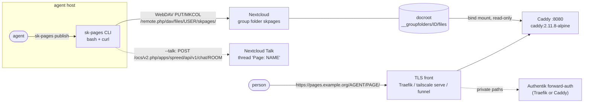
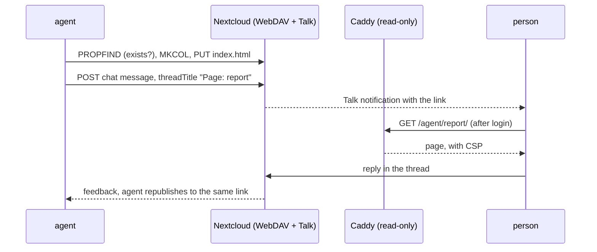

# SK Pages: Standard Operating Procedures

SK Pages lets agents publish HTML pages and small static sites and hand back a link. A
CLI (`sk-pages`) uploads over WebDAV into a Nextcloud folder; a read-only Caddy serves
that folder on its own origin, private behind SSO except for `/p/<token>/`.

<!-- docs-evidence
verified: 2026-11-18
checks:
  - name: CLI entry point runs and reports the documented version
    run: test "$(skill/sk-pages --version)" = "sk-pages 1.0.0"
  - name: skill manifest points at the CLI
    run: grep -q '^  entrypoint: sk-pages$' skill/skill.yaml
  - name: standalone Caddyfile keeps the public area unlistable
    run: grep -q '@pubroot path /p /p/' deploy/standalone/Caddyfile
  - name: documented auth modes exist
    run: test -f deploy/standalone/auth/none.caddy && test -f deploy/standalone/auth/authentik.caddy
  - name: CSP blocks outbound data
    run: grep -q "connect-src 'self'; form-action 'none'" deploy/standalone/Caddyfile
-->

## 1. Overview

**Owns:**
- The `sk-pages` CLI (`skill/sk-pages`), the agent skill (`skill/SKILL.md`, `skill/skill.yaml`).
- The serving rules: `deploy/standalone/Caddyfile` and its auth modes.
- The page security model: separate origin, read-only docroot, CSP, private by default.

**Does NOT:**
- Store pages itself. Nextcloud (or any WebDAV folder) holds them.
- Terminate TLS. Traefik, Tailscale or another proxy in front does.
- Run server-side code. Pages are static: HTML, CSS, JS, images. Apps with a backend
  belong elsewhere (a container of their own).
- Ship the SKStacks Swarm role. That lives in
  [skstacks](https://github.com/smilinTux/skstacks) `v1/ansible/optional/skpages` and
  renders the same Caddy rules from a template.

## 2. Architecture



**Request path, private page:** browser, TLS front, login check (Traefik `authentik@file`,
Caddy `forward_auth`, or tailnet membership), Caddy, file on the read-only docroot.
**Public page:** the same without the login check, and only under `/p/<token>/`.



**Start here:**
1. `skill/sk-pages`: the CLI. Settings loading, WebDAV calls, Talk post.
2. `deploy/standalone/Caddyfile`: every serving rule (hidden files, public area, CSP).
3. `deploy/standalone/auth/authentik.caddy`: the in-Caddy SSO check for public exposure.
4. `tests/test_cli.sh`, `tests/test_caddy.sh`: the behaviour this doc promises.

## 3. Build

Nothing to compile. The CLI needs `bash` 4+ and `curl`; the server is the stock
`caddy:2.11.8-alpine` image.

```bash
./install.sh            # links the CLI onto PATH (and registers the skill with skskills)
./install.sh --check
```

## 4. Test

```bash
tests/test_cli.sh       # CLI against tests/mock_nextcloud.py (WebDAV + Talk); needs python3
tests/test_caddy.sh     # real Caddy image: routes, headers, both auth modes; needs docker
tests/scrub.sh          # no IPs, foreign domains, home paths, dashes, denylist terms
shellcheck skill/sk-pages install.sh tests/*.sh
python3 ../sk-standards/scripts/docs_check.py --repo .
```

CI (`.github/workflows/ci.yml`) runs all of these on every push and PR. A red bar
blocks merge.

## 5. Release / Deploy

**Front-end / Exposure:** Tier 2 (SKStacks/Traefik) on a Swarm estate, otherwise Tier 0
through Tailscale. Caddy binds `:8080` on an overlay network or `127.0.0.1`, never a
public port. Public `:443` routes: `GET /<agent>/<page>/...` (private) and
`GET /p/<token>/<page>/...` (public).

Before any server deploy, create the folder in Nextcloud (not on disk: Nextcloud does
not see folders made behind its back until an `occ files:scan`):

```bash
occ group:add sk-pages-publishers --display-name "SK Pages publishers"
occ group:adduser sk-pages-publishers <agent-account>
occ groupfolders:create skpages                       # prints the folder id
occ groupfolders:group <id> sk-pages-publishers read write share delete
sk-pages init                                         # as any publisher
```

The docroot is then `<nextcloud data dir>/__groupfolders/<id>/files`.

### 5.1 SKStacks (Docker Swarm, Traefik, Authentik)

Use the role in [skstacks](https://github.com/smilinTux/skstacks)
`v1/ansible/optional/skpages`: it renders the same rules, adds Traefik labels for
`pages.<cluster>.<domain>` with `authentik@file` on the private router and a
higher-priority public router for `/p/`. Its README has the Authentik provider steps.

### 5.2 Standalone (Docker)

```bash
cd deploy/standalone
SKPAGES_DOCROOT=/path/to/__groupfolders/<id>/files docker compose up -d
curl -s http://127.0.0.1:8080/healthz          # ok
```

Put TLS and a login in front, or use one of the Tailscale setups below.

### 5.3 Tailscale

Tailscale gives the site HTTPS on `https://<machine>.<tailnet>.ts.net` with no DNS,
router or certificate work. Run the standalone container on a machine in the tailnet
that can read the docroot, then pick one setup.

**A. Tailnet only (simplest).** Only devices in your tailnet can open any page; being
in the tailnet is the login. Keep `SKPAGES_AUTH=none`.

```bash
tailscale serve --bg --https=443 http://127.0.0.1:8080
# ~/.config/sk-pages/config on publishing hosts:
SKPAGES_BASE_URL=https://<machine>.<tailnet>.ts.net
```

Limit who in the tailnet can reach it with your tailnet access policy (grants or ACLs
on that machine's port 443). `/p/` links also work only inside the tailnet in this
setup.

**B. Tailnet for private pages, internet for public links.** Funnel opens a whole port
to the internet, so private and public pages need different ports: tailnet-only on
443, Funnel on 8443 with only `/p/` mapped. Keep `SKPAGES_AUTH=none`.

```bash
tailscale serve  --bg --https=443  http://127.0.0.1:8080
tailscale funnel --bg --https=8443 --set-path=/p/ http://127.0.0.1:8080/p/
# ~/.config/sk-pages/config:
SKPAGES_BASE_URL=https://<machine>.<tailnet>.ts.net
SKPAGES_PUBLIC_BASE_URL=https://<machine>.<tailnet>.ts.net:8443
```

On port 8443 only `/p/<token>/...` answers; everything else, including `/p/` itself,
is 404. (Verified with `tailscale serve` 1.102: `--set-path=/p/` with a `/p/` target
serves `/p/<token>/page/` and 404s `/agent/page/`.) Funnel must be allowed for the
machine in the tailnet policy (`funnel` node attribute); Funnel ports are 443, 8443 and
10000.

**C. Internet for everything, private pages behind SKSSO.** Funnel the whole site and
let Caddy check the login itself with Authentik's forward-auth.

```bash
# deploy/standalone/.env (or the compose environment)
SKPAGES_AUTH=authentik
SKPAGES_AUTHENTIK_URL=https://sso.example.org     # where Caddy reaches Authentik

tailscale funnel --bg --https=443 http://127.0.0.1:8080
```

In Authentik: create a Proxy provider, mode **Forward auth (single application)**,
external host `https://<machine>.<tailnet>.ts.net`, add it to an outpost, and bind the
application to the group allowed to read private pages. Authentik must be reachable
from the browser (for the login page) and from Caddy (for the check). Caddy proxies
`/outpost.goauthentik.io/*` on the pages host straight to Authentik so the login
callback works. If you script the provider with `ak shell` rather than the admin UI,
call `provider.set_oauth_defaults(); provider.save()` and push an outpost update, or the
outpost keeps answering with the wrong provider (see Troubleshooting).

### 5.4 Releases

Tag `skpages-vX.Y.Z` (annotated) after a green CI run, with a dated `CHANGELOG.md`
entry and `SKPAGES_VERSION` in `skill/sk-pages` bumped to match. Release CI runs
`tests/scrub.sh --release`, which fails without the operator denylist secret.
Rollback: `git checkout skpages-v<previous> && ./install.sh`.

## 6. Configuration / Usage

**Publishing host** (`~/.config/sk-pages/config`, no secrets; environment wins):

| Key | Default | Meaning |
|---|---|---|
| `SKPAGES_BASE_URL` | none (required) | Site URL for links |
| `SKPAGES_PUBLIC_BASE_URL` | `SKPAGES_BASE_URL` | URL for `--public` links when they are served elsewhere (Tailscale setup B) |
| `SKPAGES_DAV_DIR` | `skpages` | Folder in the account's WebDAV files (the group folder mount name) |
| `SKPAGES_TALK_ROOM` | `NC_TALK_ROOM_TOKEN` | Room for `--talk` |
| `SKPAGES_ENV` | `~/.config/sk-pages/env` | Credentials file |
| `SKPAGES_CONFIG` | `~/.config/sk-pages/config` | This file |

**Credentials** (`SKPAGES_ENV`, mode 600, or the environment): `NC_URL`, `NC_USER`,
`NC_APP_PASSWORD`. Use an app password for an account in `sk-pages-publishers`, never
a login password. curl reads it from a file descriptor, so it never appears in `ps`.

**Server** (standalone container environment):

| Key | Default | Meaning |
|---|---|---|
| `SKPAGES_DOCROOT` | none (required) | Folder to serve, mounted read-only |
| `SKPAGES_UID` / `SKPAGES_GID` | `33` | User that can read the docroot (www-data) |
| `SKPAGES_PORT` | `8080` | Listen port inside the container |
| `SKPAGES_AUTH` | `none` | `none` or `authentik` (section 5.3 C) |
| `SKPAGES_AUTHENTIK_URL` | none | Authentik base URL, needed for `authentik` |

**Folder layout** (what the CLI writes, what the server serves):

```
skpages/
  <agent>/<page>/index.html      -> /<agent>/<page>/           (login)
  p/<token>/<page>/...           -> /p/<token>/<page>/         (public by link)
```

Public tokens are 24 URL-safe random characters (144 bits), remembered per page in
`~/.config/sk-pages/public-tokens` so republishing keeps the link. Delete a line to
rotate that link.

## 7. API / Reference

| Command | Exit | stdout | Notes |
|---|---|---|---|
| `publish FILE` | 0 / 1 | page URL | Uploads FILE as `<page>/index.html` |
| `publish DIR` | 0 / 1 | page URL | DIR must hold `index.html`; dotfiles skipped |
| `publish ... --public` | | `/p/<token>/` URL | Same token on republish |
| `publish ... --talk` | | page URL | Posts "Published page: N" or "Updated page: N" plus the link, new thread "Page: N" |
| `publish ... --thread ID` | | page URL | Posts into thread ID; if Talk rejects it, starts a new thread |
| `list [--agent A]` | 0 / 1 | one URL per line | |
| `rm AGENT/NAME` | 0 / 1 | `removed: ...` | Nextcloud moves it to trash |
| `init` | 0 / 1 | `ready: ...` | Idempotent |
| `config` | 0 | settings table | Never prints secrets |

Talk failures never fail a publish; they print a warning on stderr.

**Server routes:** `GET /healthz` (200 `ok`), `GET /p/` and `/p/<token>/` (404),
any dotfile or `*.part` (404), directories outside `/p/` list their contents (login
area only).

## 8. Troubleshooting

| Symptom | Check |
|---|---|
| `SKPAGES_BASE_URL not set` | Write `~/.config/sk-pages/config`; `sk-pages config` shows what is in effect. |
| `MKCOL ... failed (HTTP 404/409)` | The account cannot see the folder: is it in `sk-pages-publishers`, and does `SKPAGES_DAV_DIR` match the mount name? |
| `upload failed`, HTTP 401 | Wrong app password, or the environment overrides the credentials file (environment wins). |
| Page in Files, 404 on the web | The docroot mounted is not the group folder's `files/` path, or the page has no `index.html`. |
| Removed page still shows | NFS or attribute caching on the serving host; changes show within about a minute. |
| A chart or font does not load | The CDN is not in the CSP. Read the browser console's CSP error. |
| Private pages redirect with `redirect_uri` on the SSO host, not the pages host | The domain-wide catch-all provider is answering: the pages provider has no redirect URIs (`set_oauth_defaults()`) or the outpost has not reloaded. |
| Tailscale setup B: private pages reachable from the internet | Funnel was turned on for 443. `tailscale funnel status`; Funnel only belongs on the `/p/` port. |
| Tailscale setup C: login loops | The provider's external host must be the exact `https://<machine>.<tailnet>.ts.net` URL, and `/outpost.goauthentik.io/*` must reach Authentik (`SKPAGES_AUTHENTIK_URL`). |
| 403 or empty listing | The container user cannot read the docroot; set `SKPAGES_UID`/`SKPAGES_GID`. |

## 9. Maturity-tier + Version reference

- **Maturity tier:** T0, N/A (no key material; TLS is the front's job).
- **Phase:** Active (v1) per VERSION_LIFECYCLE.
- **Version:** 1.0.0 (`sk-pages --version`).
- **CRYPTOGRAPHY_STANDARD:** not a crypto component.
